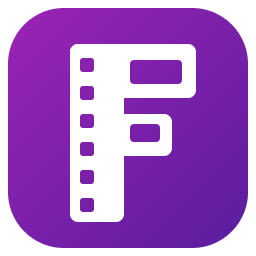
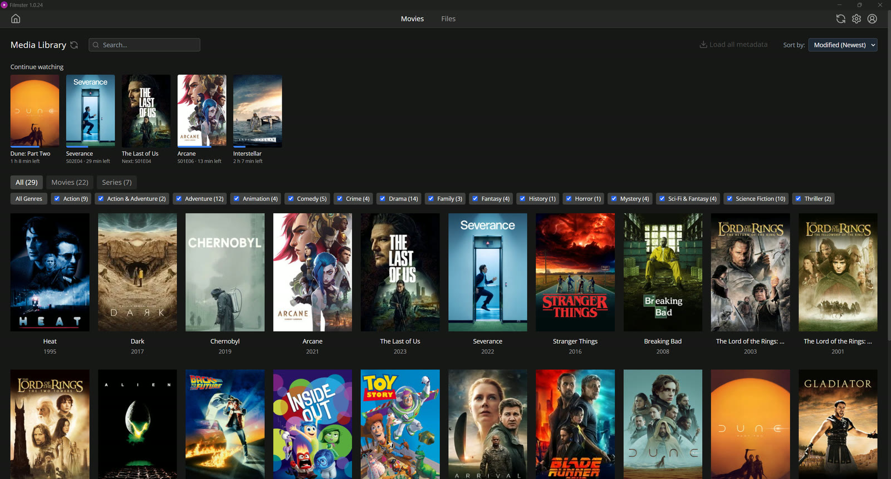
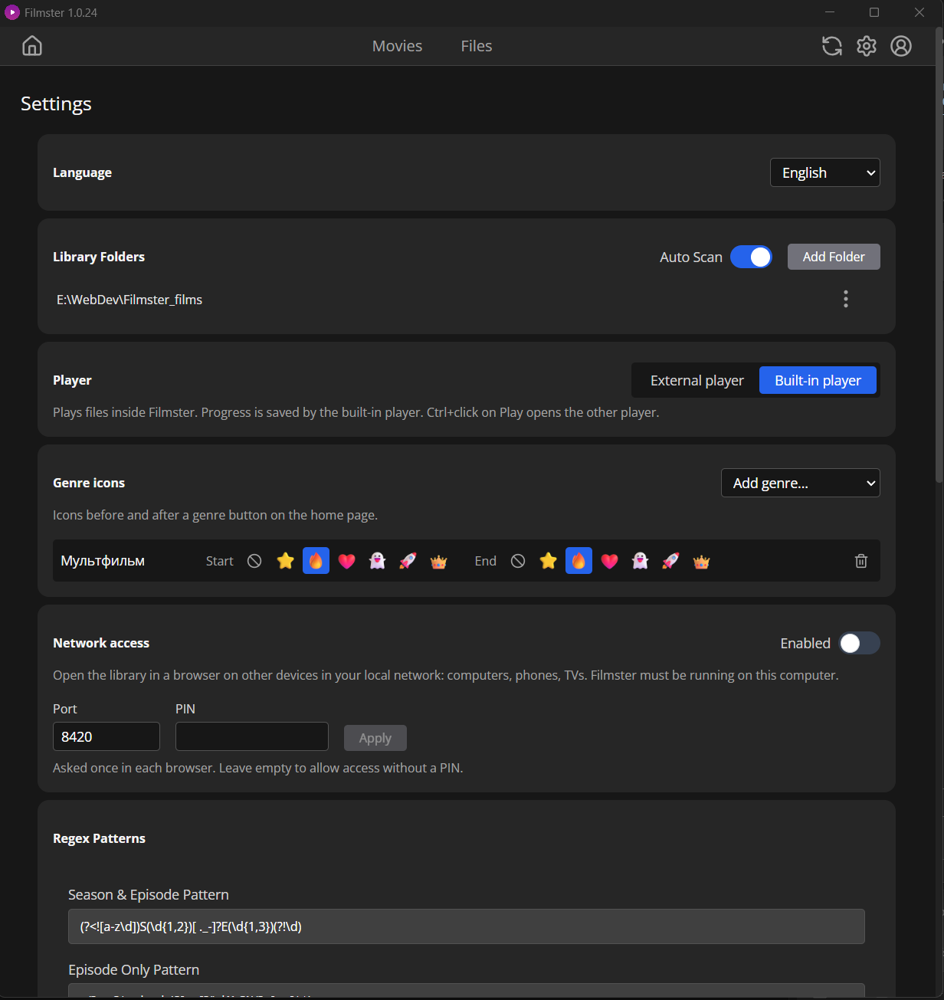

<h1 align="center">Filmster</h1>

A desktop library for your movies and TV shows on Windows. Point it at the folders with your video files and get a poster wall with descriptions and genres, a built-in player that remembers where you stopped, and the same library in a browser on any device in your home network.

## Features

- **Library from your folders** - movies and series are recognized from file and folder names (title, year, season and episode, quality); with auto scan on, new files appear by themselves
- **Metadata from TMDB or Kinopoisk** - posters, descriptions and genres are loaded for new files; any match can be corrected by hand
- **Search** by title or file name (`Ctrl+F`), also typed in the wrong keyboard layout; filters by type and genre, sorting
- **Continue watching** - unfinished movies and the next episode of a series on top of the home page
- **Groups** - drag one card onto another to group parts of a franchise or several versions of a movie
- **Built-in player** - exact seeking, audio track selection (AC3/DTS are converted on the fly), subtitles from the file or next to it, resume from the last position. Or open files in the default Windows player: MPC-HC history counts as progress
- **Network access** - open the library in a browser on another computer, phone or TV in the same network, optionally with a PIN; can be added to a phone's home screen
- **Profile** - watched movies and episodes, hours, favorite genres
- **Updates** - new versions are downloaded in the background and installed when you close the app; can be turned off to check by hand
- Multilingual interface

## Install

Download the installer (`Filmster-Setup-<version>.exe`) from the [Releases](../../releases) page and run it. Then in **Settings**:

1. Add the folders with your movies and series.
2. Enter a [Kinopoisk API Unofficial](https://kinopoiskapiunofficial.tech) key and/or a [TMDB](https://www.themoviedb.org/settings/api) API key to load posters and descriptions.
3. Optionally turn on **Network access** and open the shown address on another device.

## License

[GPL-3.0](LICENSE), (C) 2025-2026 Sorcer. The installer includes [FFmpeg](https://ffmpeg.org) binaries built by [gyan.dev](https://www.gyan.dev/ffmpeg/builds/), also under the GPLv3.
